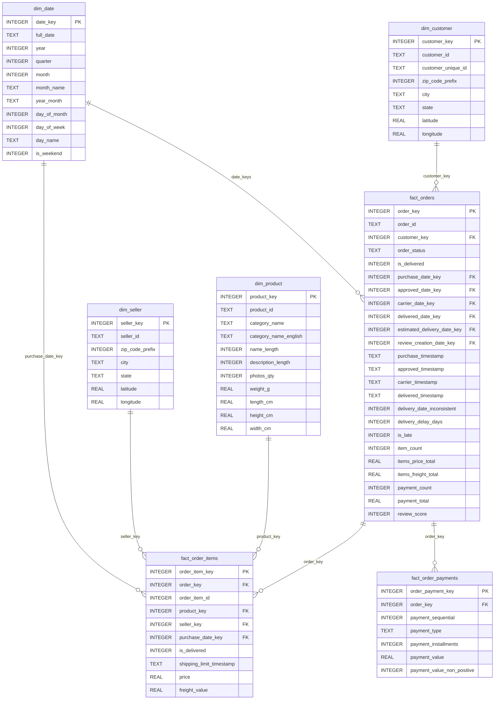

# Olist star schema

## Overview

The star schema provides an analysis-ready model for the Olist marketplace data while
keeping order-grain measures separate from item-grain measures. The star database is
built from the cleaned staging database by the `model` stage.

## Grain table

| Table | Grain | Expected rows |
|---|---|---:|
| `dim_date` | One row per calendar day | 1,096 |
| `dim_customer` | One row per source `customer_id` | 99,441 |
| `dim_product` | One row per product | 32,951 |
| `dim_seller` | One row per seller | 3,095 |
| `fact_orders` | One row per order | 99,441 |
| `fact_order_items` | One row per order item | 112,650 |
| `fact_order_payments` | One row per payment row | 103,886 |

## ER diagram

The `dim_date` table is referenced several times by `fact_orders` for purchase,
approved, carrier, delivered, estimated, and review creation dates.

## Design decisions

1. Keep order-grain facts in `fact_orders`, item-grain facts in `fact_order_items`,
   and payment-row facts in `fact_order_payments` so order-grain measures are never
   double-counted across items.
2. Use `customer_id` as the dimension grain and keep `customer_unique_id` for repeat
   buyer analysis; the data contains 96,096 real people, 2,997 repeat buyers, 250 people
   with more than one ZIP, and 39 with more than one state.
3. Do not create a separate geography dimension; latitude and longitude live on
   `dim_customer` and `dim_seller`.
4. Use surrogate integer keys on dimensions while retaining the natural source IDs.
5. Keep all orders, including orders without items. Revenue is the sum of `price` for
   delivered orders, with freight reported separately.
6. Use a calendar dimension spanning 2016-01-01 through 2018-12-31.
7. Exclude review comment text from the model; retain review score and relevant dates.

## Conventions

- Date keys are integers in `YYYYMMDD` form.
- Flags are stored as `0`/`1` integers.
- Money is stored as `REAL`; compare monetary calculations with `ROUND(x, 2)`.
- `review_score` is `NULL` when an order has no review.
- `delivery_delay_days` and `is_late` are `NULL` unless the order is delivered and
  consistent.
- Item and payment totals are `0` when an order has none.
- Latitude and longitude are `NULL` when the ZIP has no geolocation row.
